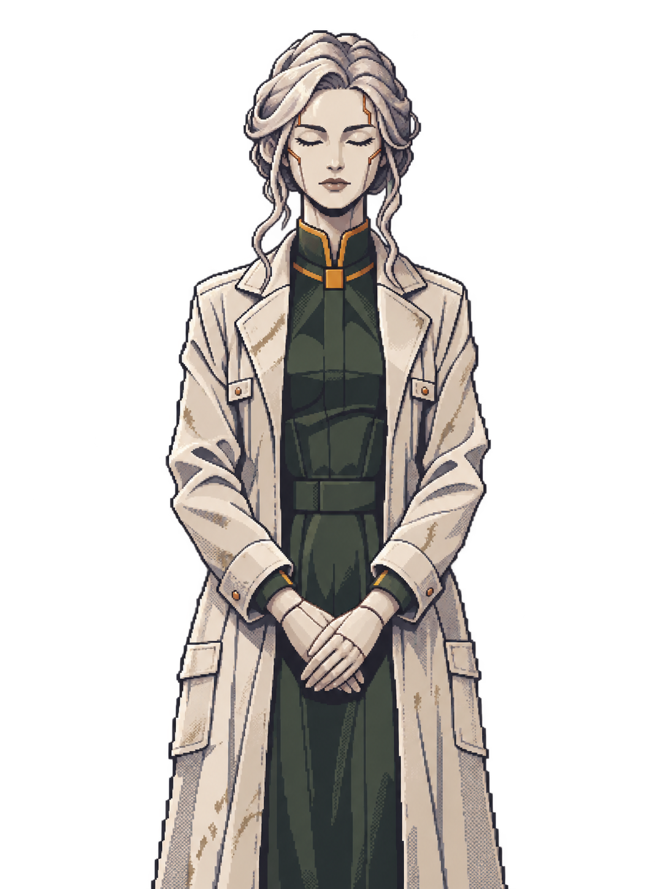
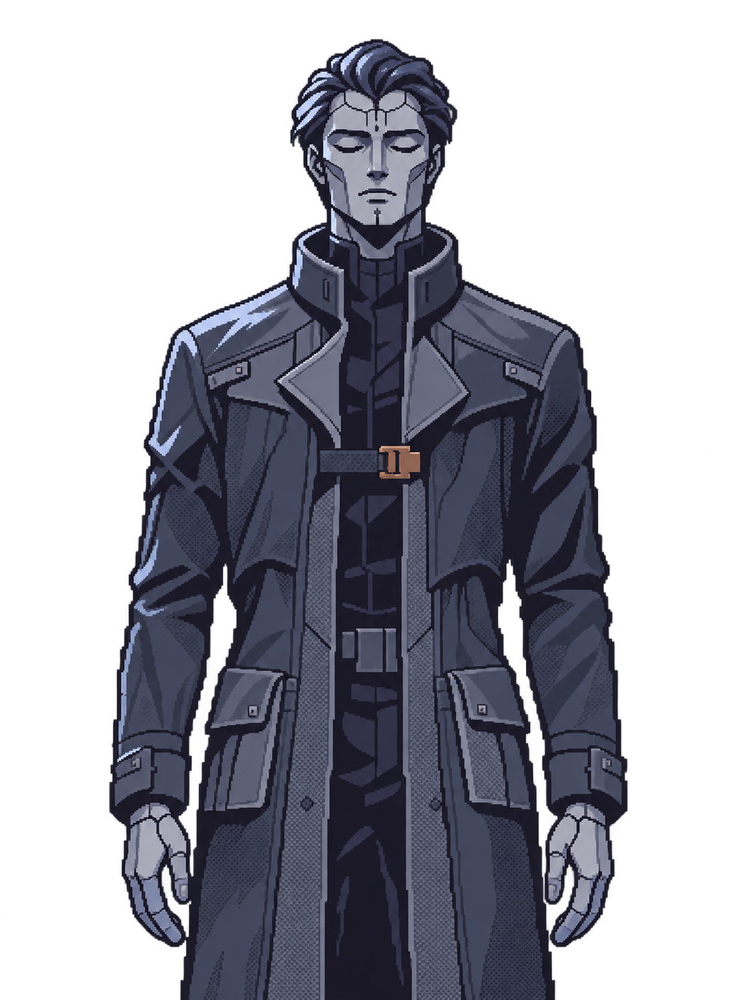
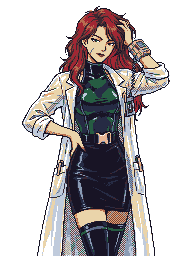
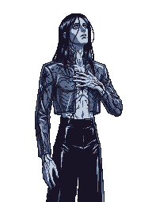

# Voidle Anlatı Sistemi

İlk tasarım paketi · 7 Kasım 2026 · NarrativeDesign

Voidle’da oyuncu koloniyi kurarken hikâyeyi yaptığı işlerin sonucunda öğrenir. Şehir kurmak oyuncunun yetkiyi kullandığı ilk andır. İlk kazı, koloninin bu dünya hakkında bildiklerini değiştirir ve danışman kadrosunu genişletir. Ay’a ve daha uzağa gitmek, ekonomide açılan yeni ölçeklerin yanı sıra hikâyede cevaplanacak sorular doğurur.

Bu dosya paketin giriş noktasıdır. Başka bir yapay zekâya aktarırken `narrative` klasörünü `sources/` alt klasörüyle birlikte paylaş. Aşağıdaki özet başlangıç bağlamını, kaynaklar ise sahne taslaklarını, ses rehberlerini ve portreleri taşır.

## Kararların durumu

| Etiket | Anlamı |
| --- | --- |
| **Karar** | Kullanıcının seçtiği anlatı veya sistem kuralı. |
| **Yazım** | Doğrudan uygulanabilecek, sonradan düzenlenebilir sahne veya lore tercihi. |
| **Öneri** | Üzerinden konuşabileceğimiz bir tasarım. |
| **Açık** | Sıradaki tasarım oturumlarından birinde doldurulacak alan. |
| **Mevcut** | İncelenen Godot kaynaklarında görülen davranış. |
| **Kaynak taslağı** | Eski konuşmadan, exposition metninden, sahne taslaklarından veya ses rehberlerinden alınan içerik. |

Bu paket anlatı tasarımının ve bu tasarımla eklenen oyun kurallarının kaynağıdır. Mevcut davranış için güncel oyun kodu ve aktif denge profili kullanılır. Ekler aralarında ayrıştığında farklı sürümler [Hikâye](STORY.md) ve [Diyaloglar](DIALOGUE.md) içinde kayda alınır.

## Devralmak için gereken özet

### Dünya ve ilk oturum

- **Karar.** Dünya’da nükleer savaş **2200 yılında** başlar. **Kaynak taslağı.** Lazarus Projesi, insanlığı yeniden kurmak için embriyo taşıyan sekiz tohum gemisi yollar. Altısının motoru arızalanır. **Aniara**, yolculuk sırasında bir kozmik varlıkla karşılaşan yedinci gemidir. Taslak, Aniara’yla bağlantılı bilinçlerin bu varlıkla hâlâ tartıştığını söyler. Bu bilinçlerin kim olduğu ve varlıkla nasıl iletişim kurdukları belirsizdir. **I-330**, oyuncunun kolonisini taşıyan sekizinci gemidir. Bir solucan deliğinden geçip hedefe benzeyen, yıldız haritası uyuşmayan bir dünyaya ulaşır. Mother Superior ve High Father, I-330’u yöneten sentetik zihinler ve İlk Kural Kitabı’nın imzacılarıdır.
- **Karar.** İnişten sonraki 25 yılda gemideki embriyolardan ilk koloni kuşağı yetişir. Açılışta oyuncu dahil **17.490 kurucu** 25 yaşındadır ve koloni kalıcı bir şehir kurmaya hazırdır. Nüfus eşiği, varsayılan ilk City tamamlandığındaki kapasiteye eşittir. **Yazım.** Gemi takviminde iniş 2440, açılış 2465. [Hikâye ve nüfus hesabı](STORY.md)
- **Karar.** Yeni oyunda ana dünya hemen görünür. Kısa ön anlatım ve AI diyaloğundan sonra oyuncu Mother Superior veya High Father'ı seçer. Seçilen AI yetkiyi teslim eder ve ilk City hedefini açar. Öğretici New Game'de zorunludur. Kazılar ayrı ilerler ve oyuncu onları erteleyerek son rokete ulaşabilir. Etkin AI, açık kazıları arada hatırlatır.
- **Karar.** Oyuncu Bolo'yla ilk ana dünya kazısının sonuç sahnesinde tanışır. Kazıyı ertelediyse uzay limanındaki kısa görüşmede Bolo Ay seferine ve Companions'a katılır. Bolo'nun aldığı sinyal Ay'daki The Rim Echo kazısını işaret eder. Oyuncu o kazının sonucunda Burkai'yle tanışır ve onu danışman kadrosuna ekler. [İki tanışma yolu](SCENES.md#the-toppled-stones-ve-bolo)
- **Karar.** Bolo'nun geçmişi Ece sahnelerine dayanır. İki tanışma yolunda da Bolo, yeraltında büyüdüğünü ve halkının Büyük Sel'den beri orada yaşadığını anlatır. Bolo adını geminin indiği gece diktiği incir ağacından alır. Burkai Ay'da ona Ece diye seslenince oyuncu asıl adını öğrenir. Beş ana dünya kazısı tamamlanınca Bolo halkının tamamı adına katılım teklifini getirir. Kabul, bir ilk City kadar Population kapasitesi ekler. [Katılım sahnesi](STORY.md#bolonun-halkı-ve-yüzeye-çıkma-teklifi)

### Danışmanlar ve sunum

- **Karar.** İki AI, Bolo ve Burkai Companions ekranını paylaşır. Etkin danışman gündelik konuşmaları ve bonusu üstlenir. Her atama en az **5 oyun yılı** sürer. 50 birikmiş görev yılı yarım kalp ve bir kişisel konuşma açar. Her tam kalp bonusu iki yüzde puanı artırır. Başlangıç +%10, 500 yılda beş kalple +%20. İleride karşılaşılacak kişiler için adsız **???** kartları gösterilebilir. [Bonuslar ve kalpler](ADVISORS.md#arkadaşlık-ve-kalpler)
- **Karar.** Aktif danışman aralıklı boşta konuşmalar yapar ve olaylara tepki verir. Kazı hatırlatmaları da aynı veri dosyasındadır. Yazılmış hikâye sahnelerinde ilgili karakterler kendi repliklerini söyler. [Replik CSV'si](data/advisor_barks.csv)
- **Karar.** Diyaloglar portre ve metnin yan yana durduğu visual novel panelinde görünür. Oyuncu gösterilmiş konuşmaları Narrative Log'dan tekrar okuyabilir. **Yerleşim taslağı.** Panel varsayılan olarak altta, alt alan yetmediğinde mevcut öğreticinin üstteki anlatım bölgesindedir. [UI tasarımı](UI.md)
- **Öneri.** Açılış, tanışma ve hikâye seçimleri panelde sahne olarak işlenir. Gündelik danışman konuşmaları kısa kalır. İpuçları kapalıyken ana sahneler erişilebilir olur. Görev kartı yapılacak işi, diyalog paneli kimin neden konuştuğunu taşır.
- **Karar.** Kalıcı kayıtlarda çevrimdışı ilerleme her zaman açıktır. En fazla **24 gerçek saat** sayılır. Takvim, üretim, tüketim ve işler aynı **%10 hızda** ilerler. Üst sınırda 2 saat 24 dakikalık normal oyun süresi ve 36 oyun yılı uygulanır. Etkin danışman, Facilitator I-330'daki koruyucu uykudan çıktığında gerçekleşen olayları anlatır. [Çevrimdışı kurallar](ADVISORS.md) · [Olay verisi](OFFLINE_EVENTS.md)

### Uzun hikâye

**Karar.** Paket, ana ve yan sahneleriyle ilk gezegen varışına kadar olan Tip 0'ı kapsar. Bolo ilk tanışmada yaşlanmadığını düşündüren ölçümlerinden söz eder. Burkai Ay'da Bolo ile Facilitator'ın neden yaşlanmadığını açıklar. Bu keşif, başka dünyalarda kalıcı üsler kurma görevine bağlanır. **Yazım.** Açılıştaki yıldız haritası uyuşmazlığı, Bolo'nun Ay sinyali ve roketin varışında kaydedilen yeni ses daha uzak hikâyelere işaret eder. Kalp konuşmaları karakterleri ana seferin adımlarından bağımsız tanıtır. [Hikâye](STORY.md) · [Sahneler](SCENES.md)

## Karakter portreleri

Ece, oyuncunun **Bolo** adıyla tanıştığı karakterdir. Aşağıdaki PNG'ler diyalog paneli ve Companions için portre kaynaklarıdır. İki AI portresi, verilen Bolo ve Burkai görsellerinin piksel üslubu referans alınarak üretildi.

| Mother Superior | High Father |
| --- | --- |
|  |  |

| Bolo (Ece) | Burkai |
| --- | --- |
|  |  |

## Özgün anlatı kaynakları

Bu dosyalar tasarımda başvurulan özgün metinlerin kopyalarıdır. Ses, sahne ve geçmiş için referans olarak okunur. Uygulama için bu paketteki **Karar** etiketli hükümler ve güncel oyun kaynakları kullanılır. Seçim bekleyen kaynak ayrımları [Hikâye](STORY.md#birbiriyle-ayrışan-kaynaklar) içinde kayıtlıdır.

| Kaynak | Kullanım |
| --- | --- |
| [Voidle açılış metni](sources/voidle-exposition.txt) | Lazarus, Aniara, I-330 ve İlk Kural Kitabı. |
| [Ece sahneleri](sources/ece-scenes.txt) | İlk kazı sonrasında Bolo'yla tanışma, iş birliği teklifi ve Ay sinyali. |
| [Burkai sahnesi](sources/burkai-scenes.txt) | Ay'daki karşılaşma, Ece adının açığa çıkışı ve diske ilişkin ipuçları. |
| [Bolo Voice Bible v1](sources/bolo-voice-bible-v1.md) | Bolo'nun ses tonu, kelime seçimi ve örnek replikleri. |
| [Burkai Voice Guide](sources/burkai-voice-guide.md) | Burkai'nin ses tonu, tavrı ve örnek replikleri. |
| [Caretaker olay replikleri](sources/caretaker-barks.md) | Mother Superior ve High Father'ın konuşma biçimleri ve olay tepkileri. |

## Dosyalar

| Dosya | Bir sonraki tasarımcı burada ne bulur? |
| --- | --- |
| [STORY.md](STORY.md) | Arka plan, açılış ve ilk kazı olayları, Ay’a giden mevcut ipuçları, sürümler arasındaki kanon ayrımları. |
| [UI.md](UI.md) | Açılış akışı, uyarlanan diyalog paneli, Narrative Log, Companions ve dönüş özeti. |
| [DIALOGUE.md](DIALOGUE.md) | Karakter sesleri, gündelik konuşma kuralları ve İngilizce replik CSV'si. |
| [SCENES.md](SCENES.md) | Açılıştan ilk gezegen varışına kadar İngilizce satırlar, seçenekler ve sahne sonuçları. |
| [IMPLEMENTATION.md](IMPLEMENTATION.md) | Godot giriş noktaları, tetikleyiciler, kazı eşlemeleri, kayıt alanları ve eski kayıt davranışı. |
| [OFFLINE_EVENTS.md](OFFLINE_EVENTS.md) | Büyük ve küçük olay CSV'leri, seçim kuralları, harita etkileri ve dönüş raporu. |
| [ADVISORS.md](ADVISORS.md) | Danışman açılması, seçim, bekleme süresi, bonus, dönüş raporu ve kayda alınacak durumlar. |
| [ROADMAP.md](ROADMAP.md) | Konuları hangi sırayla kararlaştıracağımız, bir sonraki görüşmenin kapsamı, ilk dilim ve uygulama öncesi bağımlılıklar. |

## Bugünkü oyuna bağlanan yerler

| Alan | Kaynakta mevcut olan |
| --- | --- |
| Yeni oyun | [MainMenu](../../../scripts/system/MainMenu.gd) yeni kayıt ve demo girişinde [IntroCard](../../../scenes/ui/IntroCard.tscn) açıyor. Kart yörünge, Ay ve başka dünyaya roket hedeflerini özetliyor. [Eski öğretici](../../../scripts/system/TutorialManager.gd) ayrı ve varsayılan olarak kapalı. |
| İlk şehir | [PlanetaryView](../../../scripts/planetary/PlanetaryView.gd) ana dünyada ilk City yerini seçmeyi gerektiriyor. Burası ilk yönlendirmenin bağlanabileceği mevcut etkileşim. |
| Kazı | [Vesyn kazı dizisi](../../../resources/excavations/vesyn.tres) The Toppled Stones ile başlıyor. [Excavations](../../../scripts/game/excavation/Excavations.gd) kazının hazır oluşuyla sonuç sahnesinin tamamlanmasını ayrı ele alıyor. [StoryDialog](../../../scripts/ui/excavation/StoryDialog.gd) site kimliğiyle VSM sahnesi açıyor. |
| Eski yoldaş içeriği | [Sera Vale](../../../resources/companions/sera_vale.tres) ve [Dorian Hale](../../../resources/companions/dorian_hale.tres) eski kaynaklarda duruyor. Yeni kadro geçişinde bunların sahne, arayüz, bonus ve kayıt bağlantıları birlikte ele alınır. |
| İlerleme ve dönüş | [GameState](../../../scripts/game/GameState.gd) kayıt zamanını ve sefer varışlarını izliyor. Ortak Final Rocket hedefinden başlatılan seferin varışı Tip 0’ı bitiriyor. [HUDManager](../../../scripts/system/HUDManager.gd) dönüşte geçen süreyi gösteriyor. |

## Bu paketle çalışma

Önce bu özeti, ardından [uygulama rehberini](IMPLEMENTATION.md) ve [uygulama sırasını](ROADMAP.md) oku. Oyuncunun göreceği metin İngilizce, tasarım notları Türkçe tutulur. Yazım ayrıntıları doğrudan düzenlenebilir. Önemli mekanik değişiklikleri [açık kararlar](ROADMAP.md#uygulamadan-önce-kapanacak-mekanik-kararlar) üzerinden ele al. İlk uygulama dilimi için gerekli sahne metinleri, olay eşlemeleri ve kayıt davranışı bu pakette yer alır.
